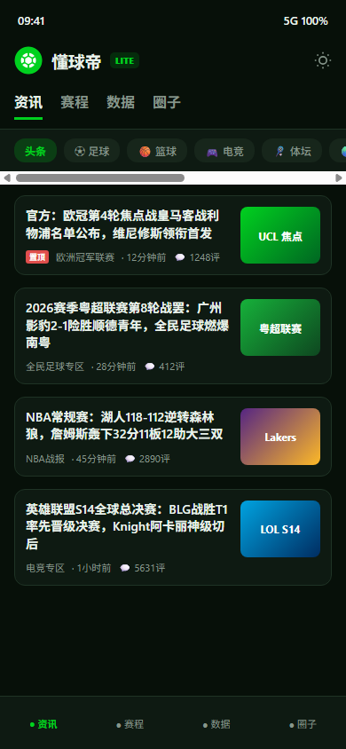
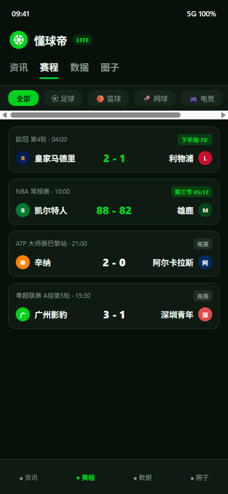
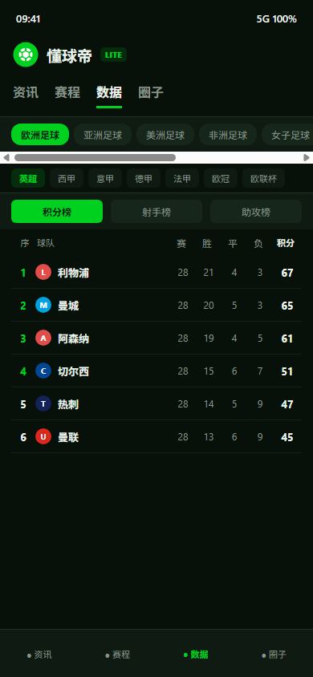

# 懂球帝 Lite (Lite-DQD)

> **极简、干净、全品类、沉浸式的体育资讯与联赛数据 Android 原生客户端**  
> 去除开屏广告、删除视频信息流及彩票等无关功能，深度还原纯粹的体育迷看球体验。

---

## 📸 应用界面截图

| 资讯首页（全品类覆盖） | 赛程中心（实时多项目） | 全品类联赛数据板 |
| :---: | :---: | :---: |
|  |  |  |

---

## 🌟 核心功能特性

### 1. 官方正版超清自适应图标
- **全新重构 Logo**：提取官方正版足球盾徽母本，去除任何低质拉伸与顶部推广条纹；
- **自适应图标支持**：遵循 Android 8.0+ 规范（`res/mipmap-anydpi-v26/`），在小米 HyperOS、ColorOS、OriginOS、原生 Pixel 等各种手机桌面的圆角、圆角矩形及水滴遮罩下均呈现正中对齐，绝无黑漆边或裁切瑕疵；
- **品牌绿高质感**：顶部导航栏与状态栏无缝融入官方绿 `#00D11F` 质感。

### 2. 全项目、全联赛数据深度覆盖
覆盖球迷关心的全部体育领域与联赛细分数据，绝无遗漏：
- **欧洲足球**：欧冠（UCL）、英超、西甲、意甲、德甲、法甲、欧联杯（UEL）；
- **亚洲足球**：中超联赛、亚冠精英联赛、沙特超（利雅得胜利等）、中甲联赛、澳超；
- **美洲足球**：美职联（MLS 东西部分区）、解放者杯、巴甲、阿超；
- **非洲足球**：非洲国家杯（AFCON）、非洲冠军联赛（CAFCL）；
- **女子足球**：中国女超联赛（中女超）、女足欧冠（UWCL）；
- **全民足球**：各省市草根超霸联赛（粤超联赛、齐鲁超、川超联赛、赣超联赛、楚超联赛、吴越杯、全国村超）；
- **篮球项目**：NBA（西部联盟、东部联盟、胜差/胜率）、CBA；
- **电竞项目**：英雄联盟（全球总决赛 S 赛、MSI）、王者荣耀（KPL 职业联赛）、DOTA2（国际邀请赛 TI）；
- **体坛与网球**：F1 世界一级方程式锦标赛（车手积分榜/车队积分榜）、ATP 世界职业男子网球巡回赛。

### 3. 多维度榜单切换
- **积分榜/排名**：实时积分、场次、胜平负、得失球数、净胜球；欧冠前四欧冠席位绿色高光凸显；
- **射手榜 & 助攻榜**：球员真实高清头像、所属球队队徽、射手排名、进球/助攻总数及点球数明细。

### 4. 赛事赛程中心
- 足球、篮球、网球、电竞、综合体坛多项目分类切换；
- 实时比分、半场/分节比分、完赛战报、进行中/直播状态清晰标识。

### 5. 社区圈子与主队关注
- 支持“设为主队”，主队专属标识一键置顶；
- 支持皇马、巴萨、曼城、阿森纳、利物浦、曼联、拜仁、国足、中超、NBA、电竞圈等热门讨论区互动与全量评论浏览。

### 6. 日夜间高对比度主题
- 专为 OLED 屏幕优化的纯黑夜间高对比度主题与舒适白天阅读主题，支持一键切换与跟随系统。

---

## 🛠️ 技术架构

- **UI 框架**：Jetpack Compose 1.7 + Material 3
- **网络通信**：OkHttp 4.12
- **图片加载**：Coil 2.7 (Compose AsyncImage)
- **页面交互**：Android WebView（文章深度长文与动态图集自适应渲染，内置广告屏蔽与横幅拦截注入引擎）
- **构建工具**：Gradle 8.9 + Kotlin 2.0.21 + Android Gradle Plugin 8.5.2

---

## 📦 APK 下载与安装

- **最新正式发布包**：[DqdLite-v2.3.apk (GitHub Release 下载)](https://github.com/whh110112/Lite-DQD/releases/download/v2.3/DqdLite-v2.3.apk)
- **全部版本发布页**：[GitHub Releases 列表](https://github.com/whh110112/Lite-DQD/releases)
- **最低兼容系统**：Android 8.0 (API Level 26) 及以上
- **推荐目标系统**：Android 14 / 15 (API Level 34 / 35)

---

## ⚖️ 免责声明与版权条款

> 1. **仅供个人学习交流使用，严禁任何商业改造**：  
>    本项目及编译生成的安装包（APK）仅供个人技术研究、Android 现代架构学习与交流使用。严禁用于任何商业用途、盈利性质运营、二次商业包装分发或网络黑产活动。  
>  
> 2. **完全基于公开资料开发**：  
>    本项目中的所有数据接口地址、字段结构与网络请求均来自于网络公开公开资料（如公开的网页版 REST 接口与移动端 Web 页面），没有使用任何未经授权的内部商业资料或私有算法。本项目未实施任何脱机解密或破解行为。  
>  
> 3. **品牌与商标权利归属**：  
>    “懂球帝”及其 Logo 图标、球队队徽、联赛标志等知识产权均归属于北京多格科技有限公司及其关联权利方所有。若权利方认为本项目涉及侵权，请通过 Issues 联系开发者，我们将第一时间响应并配合处理。
