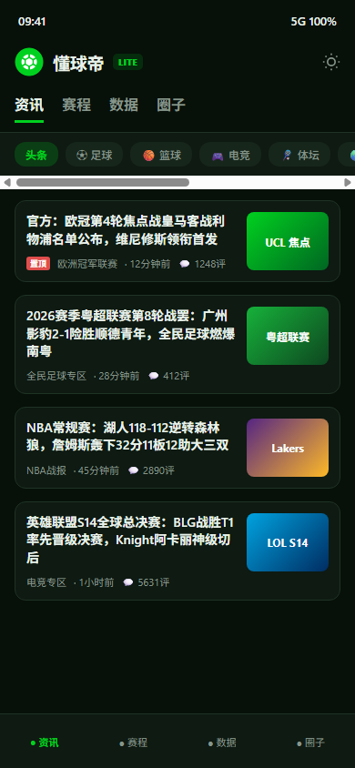
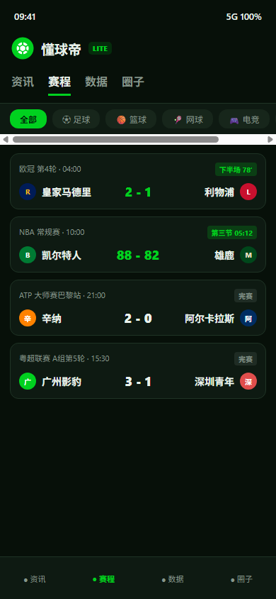
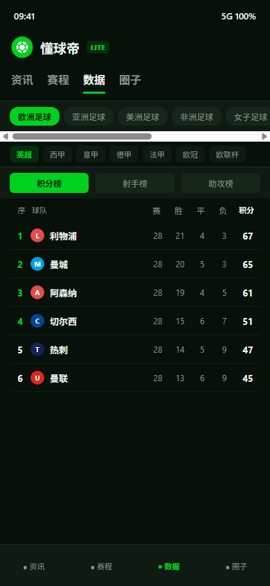

# 懂球帝 Lite (Lite-DQD)

> **纯原生、无广告、免登录的懂球帝第三方轻量 Android 客户端**  
> 基于 Jetpack Compose + Material 3 打造，全面重构为 100% 懂球帝官方原生数据流渲染，告别 WebView 套壳与信息流广告，还原纯粹、克制、流畅的看球与读报体验。

---

## 📸 应用界面截图

| 资讯首页（头条与频道流） | 赛程中心（实时比分与前瞻） | 全品类联赛数据板 |
| :---: | :---: | :---: |
|  |  |  |

---

## ✨ v3.0 ~ v3.1 核心特性

### 1. 原味视觉与高定阅读体验
- **懂球帝球场绿主场美学**：延续经典球场绿（`#16B13A`）+ 纯白卡片轻盈排版，同时提供**中性深色**与 **AMOLED 纯黑（`#000000`）** 独立开关。
- **4 档全局字号调节**：支持「紧凑 / 标准 / 大号 / 超大」四档字体缩放，长文阅读与看球数据更舒适。
- **折叠顶栏与无缝交互**：上滑自动收起顶部品牌栏，支持下拉刷新（`PullToRefreshBox`）、底部 Tab 单击回顶与无限游标翻页（`nextUrl`）。

### 2. 纯原生文章详情与精彩热评（告别 WebView 折叠）
- **100% 原生图文混排**：直连官方 `/v2/article/detail/{id}` 接口，原生渲染标题、段落、引用块、高清图集与 GIF 动图，支持点击图片全屏手势缩放与一键保存到系统相册。
- **官方热评与全量评论**：直连 `/v2/article/{id}/comment`，原生呈现「精彩热评」与「全部评论」楼中楼引用，支持加载更多评论与失败重试。
- **视频兜底兼容**：仅对包含视频的资讯保留全屏 Web 播放器入口。

### 3. 全原生比赛详情中心（赛况 + 阵容 + 赛前前瞻）
- **实时与完场赛况**：接入 `/mobile/match/situation/{id}` 与 `/lineup/{id}`，展示球场/天气/主裁信息、进球与红黄牌事件时间轴、双色控球/射门/角球统计对比条，以及双方首发 11 人与替补席。
- **赛前前瞻（v3.1 新增）**：接入 `/mobile/match/analysis/{id}`，未开赛或尚无统计的场次也能查看**对赛往绩、双方近 6 场战绩、联赛积分对比与伤停名单**。

### 4. 官方数据中台 + 原生「球队主页」与「球员主页」
- **动态全赛事目录**：直连 `/v2/config/data_menu`，涵盖五大联赛、欧冠、中超、亚洲/美洲赛事及各级别榜单，支持底部网格快速选赛事。
- **多维榜单**：积分榜（含欧冠/欧联/降级区色带与排名升降）+ 球员榜（动态加载射手榜、助攻榜、传球、红黄牌等全维度子榜）。
- **原生球队主页（v3.1 新增）**：点击积分榜任意球队或赛程队名，可查看该队**全赛季完整赛程**（点击直达比赛详情）、**多频道聚合关联新闻**、**一线队大名单**以及**俱乐部档案与主要荣誉**。
- **原生球员主页（v3.1 新增）**：点击球员榜或大名单任意球员，可查看**基本档案、技术强弱项与风格标签、所获荣誉、关联新闻、所属球队赛程**及**俱乐部履历 / 转会记录 / 伤病史**。

### 5. 全局搜索、主队关注与本地持久化
- **官方全站搜索**：接入 `api.dongqiudi.com/search`，支持搜索球队、球员并直达对应主页或一键关注。
- **我的主队与本地书签**：关注主队可持久保存并在「关注」页聚合赛程与资讯；支持本地新闻收藏与浏览足迹记录（免登录）。

---

## 🛠️ 技术架构

- **UI 框架**：Jetpack Compose + Material 3 + Navigation Compose (`NavHost`)
- **网络与解析**：OkHttp 4.12 + Jsoup 1.18（仅用于清洗正文 HTML 段落）+ 原生 `org.json`
- **图片与动图**：Coil 2.7 + `coil-gif`（支持 Android 9+ `ImageDecoder` 与低版本 `GifDecoder`）
- **本地存储**：SharedPreferences + Kotlin `StateFlow` 响应式持久化
- **测试与构建**：JUnit4 联网接口单元测试（`DqdApiLiveTest`）+ Gradle 8.9 + Kotlin 2.0.21

---

## 📦 下载与安装

- **最新正式版 (v3.1.0)**：[DqdLite-v3.1.0.apk](https://github.com/whh110112/Lite-DQD/releases/download/v3.1.0/DqdLite-v3.1.0.apk)
- **全部版本发布页**：[GitHub Releases](https://github.com/whh110112/Lite-DQD/releases)
- **系统要求**：Android 8.0 (API 26) 及以上，目标 SDK 35

---

## ⚖️ 免责声明与版权条款

> 1. **仅供个人学习交流使用，严禁任何商业用途**：  
>    本项目及编译生成的 APK 仅供个人技术研究与 Android 现代架构学习交流使用，严禁用于任何商业用途或二次打包分发。
> 2. **基于公开接口开发**：  
>    本项目所有数据均来自公开可访问的网页及移动端接口，未包含任何逆向破解或私有鉴权绕过逻辑。
> 3. **商标归属**：  
>    “懂球帝”及其相关图标、队徽、赛事标志等知识产权归属于北京多格科技有限公司及其关联权利方所有。如有侵权请联系移除。
